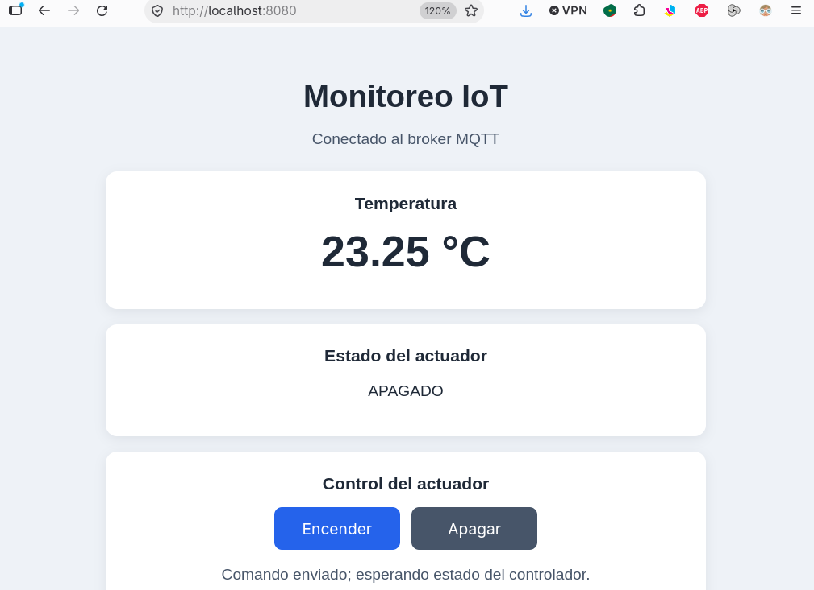
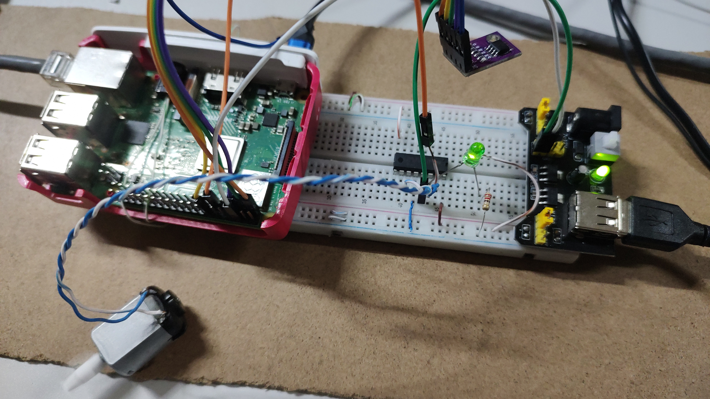
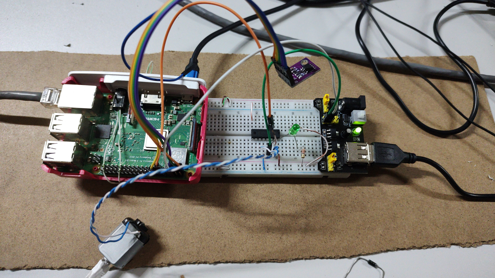

## Practica 5 Laboratorio de Fundamentos de Sistemas Embebidos

### Objetivo

Integrar una aplicación IoT utilizando una Raspberry Pi como plataforma embebida. Mediante la comunicación entre diferentes componentes de software atravez del protocolo MQTT.

El sistema deberá adquirir una medición de temperatura, publicarla mediante MQTT y permitir el monitoreo y control de un actuador mediante una interfaz web.

### Material utilizado

- Raspberry Pi 3B+ proporcionada por el profesor.

- LM75B

- L293D

- Motor DC

- Led Resistencias

- Fuente de poder 5V

### Arquitectura del sistema

Compuesto por los siguientes elementos y sus respectivas funciones:

1. **Publicador de temperatura:** Adquirir y publicar las mediciones del sensor.

2. **Controlador del actuador:** Modificar el estado de la salida en base a los comandos MQTT recibidos.

3. **Interfaz WEB:** Muestra la temperatura y permite enviar comandos de encendido/apagado 

## Desarrollo

#### 1 - Preparar el entorno y realizar una prueba

Se instalan las librerías necesarias y se habilita el servicio

```bash
sudo apt install mosquitto mosquitto-clients
sudo systemctl enable --now mosquitto
sudo systemctl status mosquitto
```

el servicio se encuentra funcionando

```shellsession
alumno@raspberrypi:~/p05 $ sudo systemctl status mosquitto
● mosquitto.service - Mosquitto MQTT Broker
     Loaded: loaded (/lib/systemd/system/mosquitto.service; enabled; preset: enabled)
     Active: active (running) since Mon 2026-11-09 12:54:36 CST; 1 week 0 days ago
       Docs: man:mosquitto.conf(5)
```

Procedemos a realizar una prueba

en una terminal

```shellsession
alumno@raspberrypi:~/p05 $ mosquitto_sub -h localhost -t /iot/temp
20.7
1500.4
```

En otra terminal

```shellsession
alumno@raspberrypi:~ $ mosquitto_pub -h localhost -t /iot/temp -m "20.7"
alumno@raspberrypi:~ $ mosquitto_pub -h localhost -t /iot/temp -m "1500.4"
```

Se observa que efectivamente se comunican atravez de MQTT

### Armado del ciruito

De acuerdo con las indicaciones del profesor se armó el circuito, que integra en la Raspberry Pi los siguientes elementos.

- Sensor de temperatura LM75B.

- Motor DC conectado al LD293D.

- Un LED de acompañamiento para observar el funcionamiento del PWM.


## Integración

### Estructura del proyecto

El proyecto se ha organizado de la siguiente manera

```shellsession
alumno@raspberrypi:~/p05 $ tree
.
├── actuator_controller.py
├── __pycache__
│   ├── sensor_reader.cpython-311.pyc
│   └── settings.cpython-311.pyc
├── requirements.txt
├── sensor_reader.py
├── settings.py
├── static
│   ├── app.js
│   └── style.css
├── temperature_publisher.py
├── templates
│   └── index.html
└── web_app.py
```

### Publicador de temperatuta

Primero leemos la temperatura del LM75B y la publicamos en el tópico **/iot/temp**

```python
"""Publica la temperatura del LM75B en /iot/temp cada segundo."""
import time

import paho.mqtt.client as mqtt

from sensor_reader import read_temperature
from settings import BROKER_HOST, BROKER_PORT, KEEPALIVE, TOPIC_TEMP


def on_connect(client, userdata, flags, reason_code, properties):
    if reason_code.is_failure:
        print(f"Error de conexión MQTT: {reason_code}")
    else:
        print("Publicador conectado al broker MQTT.")


def main():
    client = mqtt.Client(
        callback_api_version=mqtt.CallbackAPIVersion.VERSION2,
        client_id="fse-p05-temperature-publisher",
    )
    client.on_connect = on_connect
    client.connect(BROKER_HOST, BROKER_PORT, KEEPALIVE)
    client.loop_start()

    try:
        while True:
            temperature = read_temperature()
            payload = str(round(temperature, 3))
            result = client.publish(TOPIC_TEMP, payload, qos=1)
            result.wait_for_publish()
            print(f"Temperatura: {payload} °C")
            time.sleep(1)
    except KeyboardInterrupt:
        print("\nPublicador detenido.")
    finally:
        client.loop_stop()
        client.disconnect()


if __name__ == "__main__":
    main()
```

Que al ejecutarlo muestra la temperatura y la publica en el tópico

```shellsession
(.venv) alumno@raspberrypi:~/p05 $ p temperature_publisher.py 
Publicador conectado al broker MQTT.
Temperatura: 23.25 °C
Temperatura: 23.25 °C
```

### Controlador del motor

El programa en python **actuador_controller.py** realiza el apagado y encendido del motor de CD atravéz de la señal PWM hacia el LM293D. Hemos usado una señal PWM de frecuencia baja $20[Hz]$ para que sea fácilmente perceptible por el ojo humano que se trata de una señal PWM y no una señal continua. Para esto hemos colocado un LED testigo a la salida de podencia del motor.

```python
"""Recibe comandos MQTT y controla el actuador mediante GPIO17."""
import paho.mqtt.client as mqtt
from gpiozero import PWMOutputDevice

from settings import (
    BROKER_HOST,
    BROKER_PORT,
    GPIO_PIN,
    KEEPALIVE,
    TOPIC_FAN_CMD,
    TOPIC_FAN_STATUS,
)

# Se inicializa el pin como salida PWM con 20 Hz de frecuencia
actuator = PWMOutputDevice(GPIO_PIN, frequency=20, initial_value=0)


def on_connect(client, userdata, flags, reason_code, properties):
    if reason_code.is_failure:
        print(f"Error de conexión MQTT: {reason_code}")
        return

    print("Controlador conectado al broker MQTT.")
    client.subscribe(TOPIC_FAN_CMD)
    client.publish(TOPIC_FAN_STATUS, "false", qos=1, retain=True)


def on_message(client, userdata, message):
    command = message.payload.decode("utf-8").strip().lower()

    if command == "true":
        # 1.0 equivale al 100% del ciclo de trabajo
        actuator.value = 0.5 
        status = "true"
        print("Actuador encendido (PWM al 100%, 20 Hz).")
    elif command == "false":
        actuator.value = 0.0
        status = "false"
        print("Actuador apagado.")
    else:
        print(f"Comando ignorado: {command}")
        return

    client.publish(TOPIC_FAN_STATUS, status, qos=1, retain=True)


def main():
    client = mqtt.Client(
        callback_api_version=mqtt.CallbackAPIVersion.VERSION2,
        client_id="fse-p05-actuator-controller",
    )
    client.on_connect = on_connect
    client.on_message = on_message

    try:
        client.connect(BROKER_HOST, BROKER_PORT, KEEPALIVE)
        client.loop_forever()
    except KeyboardInterrupt:
        print("\nControlador detenido.")
    finally:
        actuator.value = 0.0
        actuator.close()
        client.disconnect()


if __name__ == "__main__":
    main()
```

### Interfaz WEB

Permite leer la temperatura desde una interfaz web ademas de accionar lo botones de encendido y apagado del motor.

**web_app.py**

```python
"""Interfaz web de monitoreo y control mediante MQTT."""
from threading import Lock

import paho.mqtt.client as mqtt
from flask import Flask, jsonify, render_template, request

from settings import (
    BROKER_HOST,
    BROKER_PORT,
    KEEPALIVE,
    TOPIC_FAN_CMD,
    TOPIC_FAN_STATUS,
    TOPIC_TEMP,
    WEB_HOST,
    WEB_PORT,
)

app = Flask(__name__)
lock = Lock()
state = {
    "temperature": None,
    "fan_status": None,
    "mqtt_connected": False,
}

client = mqtt.Client(
    callback_api_version=mqtt.CallbackAPIVersion.VERSION2,
    client_id="fse-p05-web-interface",
)


def on_connect(mqtt_client, userdata, flags, reason_code, properties):
    with lock:
        state["mqtt_connected"] = not reason_code.is_failure

    if reason_code.is_failure:
        print(f"Error de conexión MQTT: {reason_code}")
        return

    mqtt_client.subscribe([(TOPIC_TEMP, 1), (TOPIC_FAN_STATUS, 1)])
    print("Interfaz conectada al broker MQTT.")


def on_disconnect(mqtt_client, userdata, disconnect_flags, reason_code, properties):
    with lock:
        state["mqtt_connected"] = False


def on_message(mqtt_client, userdata, message):
    payload = message.payload.decode("utf-8").strip()

    with lock:
        if message.topic == TOPIC_TEMP:
            try:
                state["temperature"] = float(payload)
            except ValueError:
                print(f"Temperatura no válida: {payload}")
        elif message.topic == TOPIC_FAN_STATUS:
            if payload.lower() == "true":
                state["fan_status"] = True
            elif payload.lower() == "false":
                state["fan_status"] = False


client.on_connect = on_connect
client.on_disconnect = on_disconnect
client.on_message = on_message


@app.get("/")
def index():
    return render_template("index.html")


@app.get("/api/state")
def get_state():
    with lock:
        return jsonify(state.copy())


@app.post("/api/command")
def send_command():
    data = request.get_json(silent=True) or {}
    value = data.get("value")

    if not isinstance(value, bool):
        return jsonify({"error": "El comando debe ser true o false."}), 400

    if not client.is_connected():
        return jsonify({"error": "No hay conexión con el broker MQTT."}), 503

    command = "true" if value else "false"
    result = client.publish(TOPIC_FAN_CMD, command, qos=1)

    if result.rc != mqtt.MQTT_ERR_SUCCESS:
        return jsonify({"error": "No se pudo publicar el comando."}), 503

    return jsonify({"sent": True, "command": command})


def main():
    client.connect(BROKER_HOST, BROKER_PORT, KEEPALIVE)
    client.loop_start()

    try:
        print(f"Interfaz disponible en http://<IP_RASPBERRY>:{WEB_PORT}")
        app.run(host=WEB_HOST, port=WEB_PORT, debug=False, use_reloader=False)
    finally:
        client.loop_stop()
        client.disconnect()


if __name__ == "__main__":
    main()
```

### Elementos auxiliares

**settings.py**

```python
"""Configuración compartida de la Práctica 5."""

BROKER_HOST = "localhost"
BROKER_PORT = 1883
KEEPALIVE = 60

TOPIC_TEMP = "/iot/temp"
TOPIC_FAN_CMD = "/iot/fan/cmd"
TOPIC_FAN_STATUS = "/iot/fan/status"

# Raspberry Pi 3B+: GPIO17 (BCM), pin físico 11.
GPIO_PIN = 17

# LM75B: bus I2C 1 y dirección habitual 0x48.
I2C_BUS = 1
LM75B_ADDRESS = 0x48
LM75B_TEMP_REGISTER = 0x00

WEB_HOST = "0.0.0.0"
WEB_PORT = 5000
```

**sensor_reader.py**

```python
"""Lee la temperatura del sensor LM75B mediante I2C."""
from smbus2 import SMBus

from settings import I2C_BUS, LM75B_ADDRESS, LM75B_TEMP_REGISTER


def read_temperature() -> float:
    """Devuelve la temperatura en grados Celsius."""
    with SMBus(I2C_BUS) as bus:
        data = bus.read_i2c_block_data(
            LM75B_ADDRESS,
            LM75B_TEMP_REGISTER,
            2,
        )

    # El LM75B entrega 11 bits de temperatura en complemento a dos.
    raw = ((data[0] << 8) | data[1]) >> 5
    if raw & 0x400:
        raw -= 0x800

    return raw * 0.125
```

## Funcionamiento

### Interfaz WEB



Al presionar  el botón encender se enciende el motor y el led enciende, de manera intermitente, con su frecuencia de $20[MHz]$.



Al presionar el botón de apagado este se detiene, también el LED se apaga. 



Funcionamiento en vídeo.

`[Funcionamiento en video](https://mquinteror.net/video/prac-05.mp4)

### Preguntas de análisis

1. ¿Qué función cumple el broker MQTT dentro del sistema desarrollado?
   
   El broker MQTT funciona como intermediario entre los diferentes componentes del sistema. Su función es recibir los mensajes que publican los clientes y distribuirlos a los que están suscritos a determinados tópicos. En nuestra práctica permite que el programa encargado de obtener la temperatura del sensor LM75B, el controlador del LED y la interfaz web puedan intercambiar información sin necesidad de comunicarse directamente entre ellos.

2. ¿Por qué es conveniente separar la adquisición de temperatura, el control del actuador y la interfaz web?
   
   Considero que separar estas funciones facilita el desarrollo y mantenimiento del sistema, ya que cada programa tiene una responsabilidad específica. Por un lado, el publicador obtiene las mediciones del sensor LM75B, por otro, el controlador recibe los comandos y utiliza un GPIO de la Raspberry Pi para encender o apagar el LED. Finalmente, la interfaz web permite visualizar la temperatura y enviar las órdenes correspondientes. De esta manera, cada componente puede trabajar de forma independiente y comunicarse con los demás mediante MQTT.

3. ¿Cuál es la diferencia entre el tópico de comando y el tópico de estado del actuador?
   
   La diferencia está en la información que transmite cada uno. El tópico /iot/fan/cmd se utiliza para enviar las órdenes que indican si se debe encender o apagar el LED, mediante los valores true y false, respectivamente. En cambio, el tópico /iot/fan/status comunica el estado que reporta el controlador después de procesar la orden. Así podemos distinguir entre la acción que se solicita y el estado que informa el controlador.

4. ¿Qué sucedería si el broker MQTT dejara de funcionar durante la ejecución?
   
   Si el broker MQTT dejara de funcionar, los componentes perderían el medio que utilizan para intercambiar información. El programa encargado de publicar la temperatura no podría enviar sus mediciones, la interfaz web dejaría de recibir actualizaciones y las órdenes enviadas para controlar el LED no llegarían al controlador. Por lo tanto, el sistema dejaría de funcionar correctamente como una aplicación integrada hasta que se restableciera la comunicación con el broker.

## Conclusiones

- **Guerrero Gutierres Héctor:**
  
  La práctica demostró la viabilidad y eficacia de implementar una arquitectura IoT utilizando el protocolo MQTT, superando los retos de comunicación y latencia experimentados previamente con HTTP. El modelo publicador-suscriptor evidenció ser altamente eficiente para desacoplar los componentes del sistema, permitiendo que la adquisición de datos del sensor LM75B, la interfaz web y el controlador del actuador operen de forma concurrente sin bloqueos mutuos. Asimismo, la integración del motor DC mediante señales PWM y el uso de un broker local (Mosquitto) subrayó la importancia de centralizar el flujo de mensajes para garantizar un mayor determinismo y una respuesta robusta (fail-safe) en la ejecución de comandos remotos.
- **Mendoza Gonzáles Mario:**
  
  Considero que esta práctica me ayudó a comprender mejor cómo se pueden comunicar diferentes componentes de software utilizando el protocolo MQTT. Al trabajar con las mediciones de temperatura y desarrollar el controlador para el actuador, pude entender mejor cómo funciona la publicación y suscripción a los tópicos sin que la interfaz web y el motor necesiten estar conectados directamente entre sí. También me pareció importante observar el LED de acompañamiento parpadeando a 20 Hz, ya que nos sirvió de forma práctica para confirmar que la señal PWM y los comandos de la página estaban llegando correctamente al hardware. El objetivo se cumplió.
- **Osorio Camarillo Isaac:**
  
  En esta práctica se integró una aplicación IoT completa utilizando la Raspberry Pi como plataforma central, enlazando un sensor de temperatura LM75B, un motor DC y una interfaz web a través del protocolo MQTT. A diferencia de la práctica pasada donde tuvimos muchos problemas de latencia y pérdida de paquetes, el uso del broker Mosquitto y el esquema de tópicos nos permitió una comunicación mucho más fluida y sincronizada entre los scripts de Python. El uso de un LED testigo a baja frecuencia (20 Hz) nos hizo ver la importancia de probar visualmente las señales PWM de los periféricos de forma local antes de dar por terminada la integración.
- **Quintero Rubio Martin:**  Al realizar esta práctica. Hemos demostrado las capacidades del protocolo MQTT. Como al ternativa al protocolo HTTP para cumplir el mismo propósito de comunicar varios sistemas que trabajan en conjunto.
  
  Durante la realización de la práctica fue de mucha ayuda tener presentes conceptos previos como el ciclo de trabajo y frecuencia de una señal PWM para poder diagnosticar problemas que se nos presentaron y también para mostrar el funcionamiento del mismo. También al probar este protocolo. resultó ser una excelente alternativa a las opciones que habíamos considerado para el proyecto. simplificando bastante su diseño.
